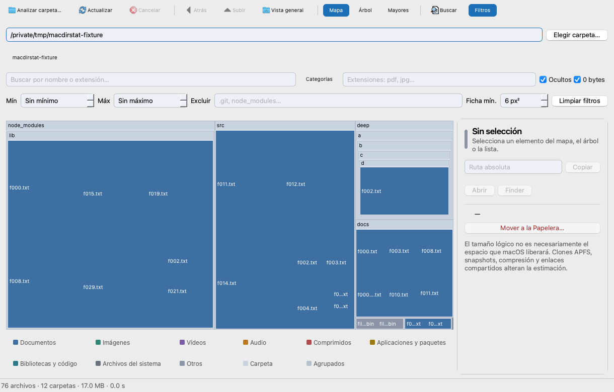

# MacDirStat

Analizador de espacio en disco para macOS, 100 % local: escanea una carpeta,
dibuja un **treemap squarified** interactivo y permite explorar qué ocupa el
espacio con mapa, árbol jerárquico y ranking de mayores consumidores. Sin red,
sin telemetría, sin privilegios de administrador y sin borrado permanente:
enviar a la Papelera siempre requiere confirmación.



<sub>Captura real de una ejecución de desarrollo; en tema oscuro:
[docs/img/captura-oscuro.png](docs/img/captura-oscuro.png).</sub>

## 1. Requisitos

- macOS **13.0 Ventura** o superior (Apple Silicon o Intel).
- Python **3.12–3.14** (entorno de desarrollo verificado: 3.13.3).
- Sin dependencias de red; único runtime: `PySide6==6.10.3`.

## 2. Instalación (desarrollo)

```bash
git clone <este-repositorio> macdirstat && cd macdirstat
python3 -m venv .venv
source .venv/bin/activate
python -m pip install --upgrade pip
pip install -r requirements.txt -r requirements-dev.txt
```

`requirements.txt` fija solo PySide6; `requirements-dev.txt` añade pytest,
pytest-qt y PyInstaller (versiones fijadas).

## 3. Ejecución

```bash
source .venv/bin/activate
python main.py                      # uso normal
python main.py --scan ~/Downloads   # abre y analiza esa carpeta
python main.py --smoke-test         # abre y cierra sola (verificación rápida)
```

La ventana recuerda tema, última carpeta, métrica, modo de mapa, filtros y
geometría entre ejecuciones (`QSettings`).

## 4. Uso

- **Analizar:** *Analizar carpeta…* (⌘O) elige una carpeta con el selector
  nativo; *Actualizar* (⌘R) repite el análisis. *Cancelar* (Esc) detiene el
  escaneo y conserva el resultado parcial.
- **Mapa:** cada rectángulo es un archivo o directorio, proporcional a la
  métrica activa. Un clic selecciona, doble clic en un directorio hace zoom y
  en un archivo lo abre. El breadcrumb (raíz › … › actual) permite subir y
  volver con *Atrás*/*Adelante* o *Vista general*.
- **Árbol:** jerarquía completa con columnas de tamaño, % y categoría;
  ordenación por columnas y expansión perezosa.
- **Mayores:** top-N de archivos y directorios (configurable), ordenado por la
  métrica activa.
- **Filtrar y buscar:** texto por nombre o `.extensión`, categorías, rango de
  tamaño, ocultos, archivos de 0 bytes y directorios excluidos. Los totales
  originales y filtrados se muestran por separado; nunca se ocultan datos en
  silencio (lo agrupado por tamaño mínimo aparece como «Otros (N)» con la
  suma exacta).
- **Detalles:** nombre, ruta, tamaño lógico/asignado/asignado único,
  porcentajes, fechas, categoría, enlaces duros y advertencias de APFS.
  Acciones: Abrir, Mostrar en Finder, Copiar ruta.
- **Papelera:** *Mover a la Papelera…* (⌘⌫) valida que el elemento siga
  coincidiendo con el disco (dispositivo, inodo y tipo), pide confirmación con
  nombre, ruta y tamaño, y usa la Papelera nativa de macOS
  (`QFile.moveToTrash`). No existe borrado permanente.

### Atajos de teclado

| Acción | Atajo | Acción | Atajo |
|---|---|---|---|
| Analizar carpeta | ⌘O | Cambiar de vista | ⌘1/2/3 |
| Actualizar | ⌘R | Buscar | ⌘F |
| Cancelar | Esc | Filtros (mostrar/ocultar) | ⌘⌥F |
| Atrás / Adelante | ⌘[ / ⌘] | Abrir archivo | ⌘↵ |
| Subir un nivel | ⌘↑ | Mostrar en Finder | ⌘⇧R |
| Vista general (raíz) | ⌘⇧↑ | Copiar ruta | ⌘⇧C |
| Zoom en el mapa | ⌘⇧O | Mover a la Papelera | ⌘⌫ |
| Métrica lógica/asignada/única | ⌘⌥1/2/3 | Localizar en el mapa | ⌘⇧L |

## 5. Arquitectura y algoritmo

- **Capas:** núcleo sin Qt (`scanner`, `models`, `layout_engine`,
  `filter_engine`), trabajadores Qt (`QThread` para escanear, `QThreadPool`
  para snapshots y layouts grandes) y UI (ventana, vistas, treemap). Detalle
  completo en [docs/architecture.md](docs/architecture.md).
- **Escaneo:** `os.scandir` iterativo con post-orden para agregados; no sigue
  enlaces simbólicos, deduce enlaces duros por inodo, no cruza montajes por
  defecto, registra errores y cancela de forma cooperativa.
- **Treemap (squarified):** divide el área contenedora en filas de rectángulos
  con proporción cercana al cuadrado, ordenando por tamaño descendente. Las
  fichas menores que el umbral de área se agrupan en «Otros (N)» (suma
  exacta, lista accesible). Dos modos: *subárbol* (todos los descendientes
  agrupados por carpeta) y *nivel actual* (solo hijos inmediatos).
- **Filtros:** un `FilterSnapshot` inmutable alimenta todas las vistas; filtrar
  o cambiar de métrica no vuelve a tocar el disco.

## 6. Métricas de tamaño y límites de APFS (resumen)

| Cifra | Origen | Advertencia |
|---|---|---|
| Tamaño lógico | `st_size` | No es espacio ocupado ni liberable |
| Espacio asignado (est.) | `st_blocks × 512` | Compresión y clones lo distorsionan |
| Asignado único (est.) | Igual, deduplicando `(dev, ino)` | Solo enlaces duros; no detecta clones APFS |

El mapa, los porcentajes y los totales usan por defecto el **espacio asignado**
(el que los datos ocupan realmente en disco); el tamaño lógico y el asignado
único siguen disponibles desde *Ver → Métrica* (⌘⌥1/2/3).
Clones APFS y snapshots no pueden atribuirse con precisión: la app no resta
estimaciones ni promete el «espacio recuperable exacto». Detalle y casos
(carpetas comprimidas, dispersas, paquetes, TCC…) en
[docs/size-methodology.md](docs/size-methodology.md).

## 7. Permisos, TCC y privacidad

- Sin red, sin telemetría, sin analítica; solo preferencias locales.
- Sin `sudo` ni privilegios; sin sandbox ni entitlements especiales.
- El selector nativo concede acceso a la carpeta elegida en esa sesión; para
  zonas protegidas (Escritorio, Documentos, Descargas, `~/Library`, partes de
  `/System/Volumes/Data`) hace falta *Acceso Total al Disco* en Ajustes del
  Sistema → Privacidad y seguridad. Sin él, el resultado es parcial y se marca
  como tal. Pasos exactos en [docs/packaging.md](docs/packaging.md) §5.
- Empaquetar la app como `.app` no concede permisos.

## 8. Pruebas

```bash
QT_QPA_PLATFORM=offscreen pytest -q          # suite rápida, sin pantalla
pytest -m macos_integration -v               # Papelera real de macOS (opt-in)
python benchmarks/make_fixture.py --files 100000
python benchmarks/bench_scan.py --fixture benchmarks/tmp/fixture-100000 --paint 60
```

Resultados reales (2026-10-17, macOS 26.6.2 arm64, Python 3.13.3,
PySide6 6.10.3):

| Suite | Resultado |
|---|---|
| `pytest -q` | **140 passed, 3 deselected** en 3.3 s |
| `pytest -m macos_integration -v` | **3 passed** (Papelera real, con limpieza verificada) |

Los 20 casos obligatorios del enunciado están cubiertos y en verde; el mapeo
caso → prueba y los casos sintéticos del treemap están en
[docs/testing.md](docs/testing.md).

### Rendimiento (fixture de 100 000 archivos, medido, no estimado)

| Medición | Valor | Objetivo del plan |
|---|---|---|
| Escaneo completo (0 errores) | 1.264 s (0.55–0.69 s en ejecuciones previas) | — |
| Progreso visible | cada ≤ 0.102 s | ≤ 200 ms |
| Cancelación | latencia 0.017 s | perceptible |
| Layout subárbol ~10 000 fichas | 0.075 s | p95 ≤ 300 ms |
| Repintado ~4 200 fichas (n=60) | p95 11.5 ms | p95 ≤ 16 ms |
| Memoria 100 000 nodos | +49.5 MB (pico total 200.6 MB) | ≤ 300 MB |

La gráfica y los porcentajes se calculan por defecto con el **espacio asignado
real en disco** (`st_blocks × 512`), no con el tamaño lógico. Detalles,
comandos y notas de metodología en [docs/testing.md](docs/testing.md).

## 9. Empaquetado

```bash
./build_macos.sh            # valida entorno, ejecuta tests, genera icono, .app y verifica
open dist/MacDirStat.app
```

- Salida: `dist/MacDirStat.app` (~96 MB, onedir, sin consola).
- Verificado en este Mac: `arm64`, `LSMinimumSystemVersion 13.0`,
  bundle `com.sergiovalle.macdirstat`, firma **ad-hoc** (`Signature=adhoc`) y
  arranque con escaneo real desde terminal y desde Finder (vía `open`).
- **No firmado con Developer ID ni notarizado** (no hay credenciales en este
  entorno): Gatekeeper puede pedir «Abrir» con clic derecho. El procedimiento
  completo (`codesign`, `notarytool`, `stapler`, `spctl`) está en
  [docs/packaging.md](docs/packaging.md), junto con arquitecturas (Intel y
  universal2 no verificadas; instrucciones incluidas) y diagnóstico de
  problemas frecuentes.

## 10. Estado y limitaciones conocidas

| Fase | Estado |
|---|---|
| 0 — Bootstrap | ✅ Cerrada (entorno, ventana, smoke test) |
| 1 — MVP funcional | ✅ Cerrada (escáner, treemap, detalles, cancelación) |
| 2 — Exploración avanzada | ✅ Cerrada (zoom/breadcrumb, árbol, mayores, filtros, leyenda) |
| 3 — Robustez y rendimiento | ✅ Cerrada (métricas, papelera segura, preferencias, benchmarks) |
| 4 — Distribución | ✅ Código y docs; ⏳ pendiente: build Intel/universal2 no verificado y firma/notarización Developer ID (sin credenciales) |

Limitaciones:

- Clones APFS y snapshots no se contabilizan con precisión (documentado; no se
  inventan estimaciones).
- Sin Acceso Total al Disco, zonas protegidas por TCC producen resultados
  parciales (siempre señalados en la UI).
- La cancelación es cooperativa: una syscall bloqueada en un volumen de red
  puede tardar en responder.
- El mapa usa `QPainter` en CPU (sin GPU); con umbrales bajos de ficha mínima
  y decenas de miles de fichas el repintado puede superar 16 ms (ver §8:
  reduce fichas con *Ficha mín.* si lo necesitas).
- La app no está notarizada todavía.

## 11. Documentación

- [docs/architecture.md](docs/architecture.md) — capas, flujo de datos,
  concurrencia, papelera.
- [docs/size-methodology.md](docs/size-methodology.md) — métricas, APFS,
  enlaces duros, TCC, comparación con Finder/`du`.
- [docs/testing.md](docs/testing.md) — matriz 1–20, resultados reales,
  benchmarks con metodología.
- [docs/packaging.md](docs/packaging.md) — build, arquitecturas, firma y
  notarización, TCC, diagnóstico.
- [plan.md](plan.md) — plan de implementación y registro de resultados.
